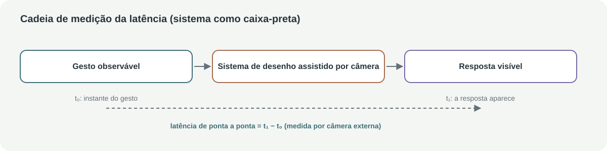
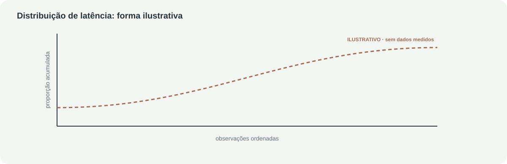
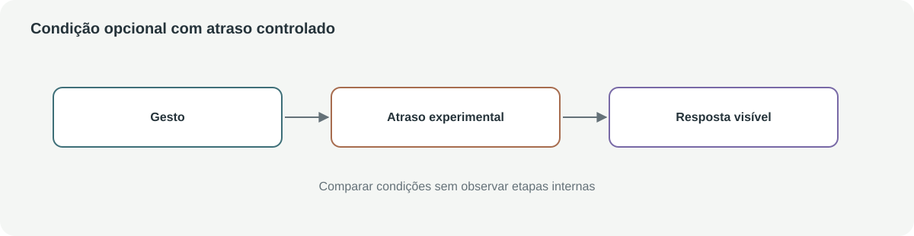

# Desempenho temporal em avaliações de interação com desenho assistido por câmera

## Resumo

A resposta temporal influencia a percepção de controle durante atividades interativas, mas “velocidade” não descreve sozinha a experiência de desenhar. A literatura de interação humano-computador distingue atraso médio, variabilidade, eventos perdidos e distribuição de latências; estudos de tinta digital também mostram que tarefas de escrita e desenho não são equivalentes a toques simples. Este artigo propõe um protocolo para avaliar externamente um sistema de desenho assistido por câmera. Define latência de ponta a ponta, jitter, perda de quadros e sumários de distribuição, incluindo mediana e caudas superiores, sem presumir um nível aceitável universal. A medição relaciona o gesto observável à primeira resposta visível, com registro de incerteza instrumental e condições de uso. O protocolo compara classes de dispositivos e atividades, e descreve uma condição opcional de atraso experimental controlado para estudar sensibilidade percebida. Uma tabela associa cada métrica à sua interpretação e às limitações. Figuras conceituais apresentam a cadeia externa, a forma ilustrativa de uma distribuição e o desenho do teste opcional. Como não há dados coletados, o artigo não atribui desempenho ao sistema; valores de referência e resultados permanecem dependentes de estudo empírico e contexto.

**Palavras-chave:** latência; jitter; interação humano-computador; desenho digital; avaliação temporal

## 1. Introdução

Em uma atividade de desenho, a pessoa observa uma marca enquanto move a mão e a ferramenta de escrita. Se a marca visível acompanha o gesto com atraso ou de modo irregular, a relação entre ação e consequência pode parecer menos direta. Essa percepção pode afetar ritmo, precisão, confiança e escolha de estratégia. Entretanto, a resposta temporal é apenas uma dimensão da interação. Uma medida rápida em média pode coexistir com pausas longas, atualizações irregulares ou perda de observações. Avaliações que reportam um único valor central podem, por isso, ocultar situações importantes para a experiência.

A literatura de interação humano-computador oferece referências clássicas para pensar a espera. Nielsen descreve valores de resposta associados à sensação de imediatismo, continuidade do pensamento e manutenção da atenção, com ênfase em que o significado depende da tarefa e do contexto. Esses valores são orientações históricas para interfaces em geral, não critérios automáticos para desenho assistido por câmera. Atividades de escrita e esboço apresentam demandas motoras e visuais próprias. Annett e colegas examinaram a percepção de latência durante tarefas de tinta digital e encontraram diferenças em relação a tarefas simplificadas de toque. Assim, transpor diretamente valores gerais para uma atividade de desenho requer validação com usuários e tarefas pertinentes.

Também importa definir onde a medição começa e termina. “Latência” pode designar o atraso entre um gesto físico e uma resposta observável, mas diferentes instrumentos capturam marcos distintos. Uma estimativa baseada em registros internos não necessariamente inclui a cadeia física completa. Uma medição externa pode observar o movimento e a resposta visível em uma gravação de alta taxa, mas depende de sincronização, resolução temporal e critério de detecção dos eventos. Por isso, o estudo deve declarar a fronteira da medida e não comparar valores obtidos por fronteiras incompatíveis.

A lacuna que motiva este artigo é a ausência de um protocolo focado na avaliação temporal externa de desenho assistido por câmera, que trate em conjunto atraso, jitter, quadros perdidos e percepção. Estudos sobre resposta em interface fornecem vocabulário e contexto; pesquisa sobre tinta digital fornece tarefas próximas; sistemas de tempo real contribuem conceitos de variabilidade e resposta. Ainda assim, essas vertentes não definem por si mesmas como estruturar uma avaliação reproduzível nesse cenário, nem justificam um único valor como aceitável para todos os usos.

A pergunta de pesquisa proposta é: **como caracterizar a resposta temporal observável de um sistema de desenho assistido por câmera durante tarefas distintas, e como relacionar essa caracterização à percepção dos usuários sem confundir associação com causa?** O objetivo é formular um protocolo para uma investigação futura, não afirmar que o sistema atual atende a qualquer requisito temporal. A análise deve considerar o contexto de uso, a tarefa, o dispositivo e a incerteza da medição.

O artigo oferece três contribuições. Primeiro, define um conjunto de medidas temporais separando latência de ponta a ponta, jitter, quadros perdidos e distribuição da resposta. Segundo, propõe um desenho de avaliação externa com classes de dispositivos e atividades, incluindo teste opcional de atraso controlado. Terceiro, organiza ameaças à validade e um formato de relato que torna comparáveis as fronteiras de medição sem expor componentes internos. Essas contribuições são metodológicas e precisam ser examinadas em estudo empírico.

A seção 2 discute pesquisa sobre resposta em interfaces, tinta digital e sistemas de tempo real. A seção 3 define as métricas e esclarece como interpretar seus limites. A seção 4 descreve condições, instrumentos externos, análise e salvaguardas. A seção 5 apresenta os campos de resultados que deverão ser preenchidos depois da coleta. A seção 6 discute desfechos possíveis; a seção 7 examina ameaças; e a seção 8 delimita as etapas necessárias antes de qualquer conclusão sobre desempenho.

## 2. Trabalhos relacionados

### 2.1 Latência percebida em interação humano-computador

A relação entre tempo de resposta e percepção de controle é discutida desde os primeiros estudos de interação com computadores. Miller analisou tempos de resposta em sistemas conversacionais, e Card, Robertson e Mackinlay discutiram o papel da latência em sistemas gráficos interativos. Nielsen sintetizou três referências de tempo para orientar o desenho de interfaces: resposta percebida como imediata, manutenção do fluxo de pensamento e sustentação da atenção. Esses valores são frequentemente repetidos como regras universais, mas o próprio contexto de uso importa. Uma ação de seleção breve não equivale a traçar uma linha contínua, e a expectativa depende do vínculo visual entre gesto e resultado.

Pesquisas posteriores investigaram a latência em tarefas motoras e perceptivas específicas. MacKenzie e Ware examinaram atrasos em interação gráfica e desempenho de apontamento. Ng e colegas estudaram a percepção de atraso em interação com caneta, comparando tarefas de arrastar e rabiscar. Annett e colegas estenderam a investigação para escrita e esboço, argumentando que tarefas de tinta precisam ser avaliadas em contexto naturalista. Esses resultados alertam que diferenças pequenas podem ser perceptíveis em uma atividade e pouco relevantes em outra. O presente artigo não transporta estimativas desses estudos para um sistema diferente; usa-os para justificar tarefas específicas e medidas externas.

A percepção também depende da representação visual. A presença da mão, da ponta da caneta e do traço pode alterar a interpretação do atraso, assim como a continuidade do feedback. O trabalho de Annett sobre tinta digital discute como referenciais visuais influenciam a percepção de latência. Estudos de tinta em realidade virtual e superfícies digitais fisicamente alinhadas relatam medições distintas para o movimento representado e para o aparecimento da tinta. Esses estudos servem como exemplos de que a definição do evento final muda a medida. Não se deve combinar resultados cuja fronteira inclua componentes diferentes sem explicitar essa diferença.

### 2.2 Resposta temporal em desenho e tinta digital

A pesquisa em computação com caneta aborda latência desde tarefas de escrita, desenho livre e interação gestual. Hinckley e colegas discutiram interação com caneta e papel digital, enquanto trabalhos de Annett investigaram percepção e comportamento em atividades de tinta. A literatura distingue a resposta associada ao movimento de um cursor da resposta de um traço que deve permanecer alinhado ao gesto. Essa distinção é importante porque uma interface pode exibir feedback antes que uma marca final esteja estabilizada, e a métrica escolhida deve dizer qual resposta está sendo observada.

Estudos de latência em tinta digital tendem a usar tarefas controladas e comparações psicofísicas para estimar quando uma pessoa percebe uma diferença. Os resultados são valiosos para estabelecer que a sensibilidade pode depender da tarefa e da configuração visual. Entretanto, os valores perceptivos observados em experimentos específicos não constituem critérios de qualidade universais. População, aparelho, postura, duração, estratégia de desenho e estímulos visuais limitam a generalização. Uma avaliação aplicada deve especificar se pretende medir diferença detectável, preferência, desempenho de tarefa ou satisfação; esses desfechos não são intercambiáveis.

A medição de resposta também requer considerar a cadeia observável inteira. Um marco inicial pode ser a ação física que inicia o traço; o marco final pode ser a primeira alteração visual que corresponde a essa ação. Para uma avaliação externa, uma gravação pode registrar simultaneamente o movimento e a superfície visual. O método deve documentar a taxa de captura, sincronização e incerteza de cada marco. Caso a gravação não permita identificar o início ou a resposta com precisão suficiente, o estudo deve declarar essa limitação em vez de atribuir uma precisão maior que a do instrumento.

### 2.3 Avaliação de sistemas interativos e tempo real

A engenharia de sistemas de tempo real distingue atraso, tempo de resposta, liberação de tarefas e variabilidade temporal. Jitter descreve a variação temporal de eventos ou respostas em relação a uma referência. Em interação, jitter pode ser percebido como irregularidade mesmo quando a latência central é baixa. A literatura de escalonamento e análise temporal explica por que médias podem ocultar ocorrências de cauda e por que pior caso, distribuição e frequência de violações respondem a perguntas diferentes. Um sistema de desenho não deve ser tratado automaticamente como sistema crítico de tempo real; os conceitos são usados aqui para estruturar medidas, não para atribuir requisitos de segurança.

A avaliação de desempenho de interfaces também recomenda separar tempo de resposta observado de tempo de espera percebido. Indicadores de progresso, feedback contínuo e previsibilidade podem influenciar a experiência sem alterar o atraso físico. Para uma atividade de desenho, uma resposta parcial pode ser percebida de modo distinto de uma pausa seguida por atualização completa. O protocolo proposto registra quadros perdidos e intervalos sem resposta junto à latência, para que a análise não reduza uma sequência temporal a um escalar.

A literatura identificada fornece conceitos e evidências parciais, mas deixa uma lacuna operacional. Faltam orientações que combinem fronteira de medição externa, distribuição, eventos perdidos, classes de dispositivos e tarefas de desenho, com relato suficiente para comparação independente. Este artigo procura preencher essa lacuna metodológica sem estabelecer um valor recomendado antes da coleta. A adequação de qualquer referência temporal deve ser investigada em relação à tarefa e às pessoas que a executam.

Uma fonte adicional de dificuldade é a comparabilidade entre instrumentos. Uma leitura de tempo registrada dentro de um equipamento, uma filmagem externa e uma inferência baseada em atualização visual podem medir intervalos diferentes. Estudos de latência em sistemas táteis e de tinta digital variam nas tarefas, nos marcos de início e fim e na forma de apresentar o feedback. Consequentemente, uma comparação bibliográfica deve descrever o que cada medida inclui. A presente proposta valoriza uma fronteira externa observável por facilitar auditoria, embora reconheça que a instrumentação acrescenta sua própria incerteza.

## 3. Enquadramento do problema

Latência de ponta a ponta é o intervalo entre um evento físico de entrada e a resposta visual correspondente. Neste artigo, o início é o primeiro instante observável do gesto relevante; o fim é a primeira mudança visível atribuível ao gesto, definida antes da análise. Para a observação i, a diferença temporal pode ser expressa como Lᵢ = tᵣ,ᵢ − t𝓰,ᵢ, em que t𝓰 representa o marco do gesto e tᵣ representa o marco da resposta. O instrumento registra esses eventos externamente, de modo que a medida abrange a cadeia observada e não o tempo de uma etapa interna.

Uma estimativa pontual não descreve todas as respostas. A distribuição deve incluir uma medida central e medidas de cauda. A mediana resume o centro sem exigir simetria; percentis superiores, como p95 e p99, descrevem respostas lentas observadas sem declarar que sejam máximos absolutos. A diferença entre percentis ou uma medida robusta de dispersão pode caracterizar a variabilidade. O protocolo seleciona esses sumários antes da coleta e os apresenta juntos. Uma média sem dispersão pode esconder pausas ou atrasos ocasionais que alterem a continuidade da tarefa.

Jitter, neste contexto, significa variação entre latências sucessivas ou entre intervalos de resposta em relação à sequência de gestos. A definição precisa dizer qual série temporal está sendo comparada. Jitter absoluto pode ser descrito pela distribuição de diferenças entre latências consecutivas; a dispersão geral da latência responde a pergunta relacionada, mas diferente. A análise deve declarar a estatística usada, pois desvio-padrão, intervalo interquartil e amplitude respondem de modo distinto a valores extremos. A designação genérica “jitter” sem definição não permite reproduzir a análise.

“Quadros perdidos” também pode significar eventos diferentes. Uma gravação externa pode perder quadros e comprometer a resolução da medida. A resposta visual pode, por sua vez, manter-se sem atualização durante um intervalo, o que pode ser descrito como pausa ou atualização ausente, desde que o registro permita observá-la. O protocolo separa qualidade da gravação, lacunas observáveis na resposta e ausência de correspondência entre gesto e resposta. Sem uma referência externa adequada, não é possível afirmar quantos quadros internos foram descartados; o artigo trata somente do que pode ser observado.

A medição de tempo depende de sincronização e precisão instrumental. Se a taxa da gravação for insuficiente, os eventos podem cair entre quadros e a diferença observada terá quantização. Se os dispositivos de captura não compartilharem uma base temporal, o deslocamento entre relógios pode se confundir com latência. A calibração deve estimar esse erro com procedimento independente da execução avaliada. O relatório apresenta a incerteza do instrumento junto das medidas, evitando escrever mais casas decimais do que a resolução permite.

Os valores clássicos de Nielsen oferecem contexto para pensar a experiência: resposta muito breve pode ser percebida como imediata, atrasos curtos podem interromper a sensação de ação direta, e esperas longas podem demandar indicação de progresso. A fonte apresenta essas referências como orientações gerais de interface, não como especificação para desenho. Elas não devem ser convertidas em critério de aprovação sem estudo contextual. O quadro temporal deste artigo serve para formular perguntas e escolher medidas, não para estabelecer um desempenho esperado.

A Tabela 1 resume as métricas e suas interpretações. Uma mesma sessão pode combinar latência central baixa com cauda longa, ou latência consistente com resposta percebida como pouco fluida. Também é possível que a percepção mude sem alteração equivalente nas medidas físicas, por causa de contexto visual, expectativa ou atividade. Por isso, medidas instrumentais e relatos de participantes são complementares, mas não substitutos.

**Tabela 1.** Métricas temporais propostas para avaliação externa, com definição operacional e interpretação; os campos separam atraso, variabilidade, perda de observações e percentis da distribuição dos resultados.

| Métrica | Definição operacional | Unidade ou resumo | Interpretação e limite |
|---|---|---|---|
| Latência de ponta a ponta | Diferença entre o marco observável do gesto e a primeira resposta visível correspondente | Tempo por observação; distribuição completa | Inclui o contexto observado, sem localizar atraso em componentes internos. |
| Mediana da latência | Valor central da distribuição de latências observadas | Medida de tempo | Resume o centro, mas não descreve a cauda lenta. |
| Percentis superiores | Quantis previamente definidos da distribuição observada | p95 e p99 | Descrevem caudas, mas não são máximos nem garantias. |
| Jitter consecutivo | Diferenças entre latências ou intervalos de resposta sucessivos, conforme definição prévia | Distribuição de diferenças temporais | Depende da série escolhida e da ordem das observações. |
| Dispersão | Variabilidade das latências em torno de seu centro | Intervalo interquartil ou outra estatística declarada | O indicador escolhido altera a sensibilidade a extremos. |
| Atualização visual ausente | Intervalo em que a resposta não apresenta a mudança correspondente ao gesto, sob observação adequada | Ocorrência e duração | Não identifica perda interna de quadros; descreve ausência externa observada. |
| Qualidade da gravação | Quadros ausentes, repetidos ou não sincronizados no registro de referência | Taxa ou contagem do instrumento | Limita validade temporal e deve ser distinguida do comportamento avaliado. |
| Percepção de continuidade | Avaliação do participante sobre acompanhamento e regularidade do traço | Escala ou relato qualitativo | É autorrelato contextual, não uma medida física de latência. |

## 4. Protocolo de avaliação proposto

O estudo compara a resposta observável em classes de dispositivos e atividades de desenho. A unidade primária é um gesto delimitado e sua resposta visual correspondente. A seleção das tarefas deve incluir movimentos contínuos, marcas breves e retomada após pausa, pois essas atividades impõem diferentes demandas de acompanhamento. O protocolo registra a superfície, a posição de uso, as condições de iluminação pertinentes e a classe do dispositivo. Modelos comerciais, parâmetros e detalhes de implementação não são necessários para interpretar essa comparação.

A primeira parte do estudo é observacional. Uma câmera externa de alta taxa registra, no mesmo campo temporal, o gesto e a resposta visível. O arranjo deve preservar visibilidade sem interferir no modo de desenhar. A equipe descreve como identifica o começo do gesto e a primeira resposta, como sincroniza registros e como estima a incerteza. Um procedimento de anotação define casos ambíguos, como gesto encoberto, resposta já presente ou pausa breve. Uma amostra de registros pode ser anotada por avaliadores independentes, e as divergências entre anotadores são relatadas para mostrar a confiabilidade da marcação.

A escolha da taxa de captura depende da pergunta e da resolução temporal necessária, e deve ser justificada antes da coleta. Ela não é escolhida para favorecer um resultado. A validação do instrumento inclui registro de uma referência temporal conhecida, verificação de quadros ausentes e comparação da sincronização ao longo da sessão. O artigo não fixa taxa ou tolerância numérica porque essas escolhas dependem da disponibilidade e da precisão do equipamento. A incerteza instrumental precisa ser pequena o bastante para sustentar a distinção pretendida; se não for, a conclusão fica limitada.

As condições incluem classes de dispositivos, sem especificar fabricantes ou modelos. A Tabela 2 propõe categorias funcionais para documentar o contexto. A equipe pode adaptar as categorias, desde que preserve as propriedades relevantes e explique as mudanças. As tarefas são repetidas em ordem balanceada ou aleatória quando isso for compatível com segurança e conforto. Se efeitos de aprendizagem ou fadiga forem plausíveis, a ordem e os intervalos entre tarefas são registrados. Não se pressupõe independência entre observações sucessivas da mesma pessoa.

**Tabela 2.** Classes de dispositivos e tarefas propostas para comparação, sem marcas ou modelos específicos; cada combinação explicita a finalidade analítica e os fatores de contexto que devem ser documentados.

| Classe de dispositivo | Atividade | Foco analítico | Contexto a registrar |
|---|---|---|---|
| Computador com câmera integrada | Traço contínuo | Acompanhamento durante gesto sustentado | Posição da tela, distância de uso e visibilidade da mão. |
| Dispositivo móvel apoiado | Marcas breves e traços curtos | Início e encerramento de respostas | Estabilidade do apoio, enquadramento e orientação de uso. |
| Câmera externa montada | Desenho com pausas e retomadas | Variação e resposta após interrupção | Posição relativa, iluminação e mudanças de cena. |
| Classe adicional definida pelo estudo | Tarefa escolhida conforme pergunta | Comparabilidade com as demais classes | Justificativa da categoria e condições não mantidas constantes. |

As métricas são computadas por participante, sessão, atividade e classe de dispositivo, conforme unidade do desenho. A tabela de resultados deve apresentar a distribuição, a mediana, percentis superiores e variabilidade. O número de observações e as exclusões são informados quando dados existirem, mas nenhum valor é antecipado nesta proposta. Para comparações pareadas, a análise estima diferenças dentro de cada pessoa quando o desenho permitir. Para classes sem pareamento, descreve-se a diferença observada com incerteza e sem atribuir causalidade a uma característica isolada do aparelho.

Uma condição opcional introduz atraso experimental controlado entre evento e resposta visível para examinar a percepção de sensibilidade temporal. A finalidade não é simular um comportamento interno do sistema, mas estudar se mudanças temporais deliberadas alteram percepção ou execução. O atraso aplicado deve ser documentado, validado externamente e apresentado como condição experimental. Participantes recebem informação ética apropriada, e a tarefa evita induzir desconforto. A ordem das condições é balanceada; os avaliadores que analisam respostas subjetivas podem permanecer sem informação sobre a condição quando isso for praticável. O desenho e a Figura 3 tratam apenas da manipulação experimental e dos eventos externos.

**Figura 1.** Cadeia externa de medição entre gesto e resposta visível, apresentada como caixa-preta. Os marcos temporais descrevem eventos observáveis, sem expor etapas internas do sistema; elaboração própria.

**Figura 2.** Forma ilustrativa de uma distribuição acumulada de latências, com eixos sem números e rótulo de ausência de dados. A forma esperada, não é resultado; elaboração própria.

**Figura 3.** Esquema de uma condição opcional com atraso experimental controlado, mostrando gesto, condição de teste e resposta visível sem atribuir valores ou expor detalhes internos; elaboração própria.

A análise combina estatísticas temporais e medidas perceptivas. Depois de cada atividade, os participantes podem avaliar continuidade, controle percebido e incômodo com a resposta, usando instrumentos definidos e justificados. Entrevistas breves ajudam a interpretar relatos discrepantes, mas não substituem medidas temporais. A relação entre medidas instrumentais e avaliações subjetivas é analisada como associação. Uma correlação não demonstra que o atraso causou determinada avaliação, pois tarefa, habilidade, expectativa e contexto podem influenciar ambas.

O plano de análise define previamente quais métricas são primárias, como tratar sessões interrompidas, quais observações são excluídas e como serão representadas incertezas. A distribuição deve ser inspecionada sem remover valores extremos apenas por serem inconvenientes. Se um valor extremo decorrer de falha no instrumento, o motivo e o critério de exclusão são reportados; se decorrer de uma resposta observada, ele permanece na análise ou é tratado em análise de sensibilidade. A versão final dos materiais, a descrição das condições e o código analítico devem permitir entender a produção dos resultados, respeitando consentimento e privacidade.

Ameaças à validade incluem erro de sincronização, resolução insuficiente, mudança de enquadramento, variação entre participantes e efeito de aprendizagem. A equipe documenta essas ameaças durante o piloto e define como limitar suas consequências. A avaliação não busca identificar o atraso de componentes internos. Seu foco é caracterizar o intervalo observável em condições especificadas e estabelecer quais inferências podem ser sustentadas pelos dados.

## 5. Estrutura dos resultados

O relatório futuro apresentará a completude dos registros, as condições executadas e as exclusões antes de expor qualquer medida temporal. Para cada classe de dispositivo e tarefa, serão descritas a distribuição das latências, sua mediana, percentis superiores e variabilidade. Serão informadas diferenças entre sessões e participantes, junto à incerteza de medição e às lacunas do instrumento. Quadros perdidos na gravação externa serão separados de pausas visíveis na resposta, pois esses eventos possuem causas possíveis distintas.

As medidas instrumentais serão relacionadas a avaliações de continuidade e controle percebido, com análise associativa e sem interpretação causal automática. A condição opcional de atraso será reportada separadamente da observação naturalista, indicando como foi introduzida e validada. Se as condições não forem comparáveis ou se a resolução do registro for insuficiente, o resultado será classificado como inconclusivo para a pergunta afetada. Nenhuma conclusão global será apresentada a partir de uma única estatística central.

A Figura 2 é apenas um exemplo de forma de apresentação: sua curva não representa observações e seus eixos não contêm números. Em uma publicação empírica, as figuras serão produzidas a partir dos registros coletados e terão a incerteza instrumental descrita. A Tabela 3 enumera campos pendentes para a aplicação do protocolo. Como não há coleta neste manuscrito, valores e comparações permanecem [PENDENTE-DADOS].

**Tabela 3.** Campos de resultado previstos para a aplicação do protocolo temporal, relacionando condição, métrica, incerteza instrumental e percepção; todas as células quantitativas aguardam coleta e análise empírica.

| Campo | Registro futuro |
|---|---|
| Distribuição por tarefa e dispositivo | 1 sessão, fonte de vídeo 0, 217 aquisições; tarefa não registrada no log. Fonte: sessão 21/11/2026 15:12 (captures/telemetry.jsonl, relatório captures/session-reports/session-20261121-151230-476-107737-0.json). |
| Mediana e percentis superiores | Detecção (n = 217): mediana 312,5 ms; p90 519,6 ms; p95 578,9 ms; máximo 739,7 ms. Passagem completa: mediana 633,5 ms; p95 1030,8 ms; máximo 1403,4 ms. Fonte: sessão 21/11/2026 15:12 (captures/telemetry.jsonl, relatório captures/session-reports/session-20261121-151230-476-107737-0.json). |
| Jitter e atualizações visivelmente ausentes | [PENDENTE-DADOS] |
| Incerteza e qualidade da gravação | [PENDENTE-DADOS] |
| Relação com continuidade percebida | [PENDENTE-DADOS] |

## 6. Discussão

Se latências e distribuições forem semelhantes entre sessões, o resultado indicará estabilidade temporal observada nas condições testadas. Não demonstrará que todas as pessoas percebem a resposta da mesma forma, nem que outras tarefas ou dispositivos produzirão resultados equivalentes. A interpretação deverá restringir-se à cobertura do estudo e considerar se as diferenças instrumentais são menores que as variações que se pretende distinguir. Sem estimativa de incerteza adequada, semelhança numérica pode refletir apenas baixa resolução.

Se as medianas forem próximas, mas as caudas divergirem, o estudo mostrará que um resumo central não descreve completamente a resposta. Pausas pouco frequentes podem ser importantes para tarefas longas, mesmo que a maioria dos gestos receba feedback regular. A análise de percentis e eventos extremos ajuda a identificar essa diferença, enquanto a inspeção dos registros externos contribui para separar fenômenos observados de falhas de captura. Essa leitura é compatível com recomendações gerais de desempenho em interfaces, mas não converte as referências de Nielsen em critério universal.

Se dispositivos ou tarefas diferirem, a comparação pode sugerir que contexto e atividade estão associados à resposta. Como essas condições podem variar em vários aspectos, diferenças entre grupos não devem ser atribuídas a uma característica isolada. Quando a pergunta exigir inferência causal sobre atraso percebido, a manipulação opcional controlada oferece evidência mais delimitada, mas ainda depende de randomização, controle de aprendizagem e validade dos instrumentos subjetivos. O resultado seguirá limitado ao experimento realizado.

Se medidas temporais e avaliações subjetivas não se associarem, isso não torna uma das fontes inválida. Pode indicar que a métrica física não captura a dimensão percebida, que o questionário é pouco sensível, ou que fatores de expectativa e contexto influenciam a avaliação. Entrevistas podem esclarecer como os participantes descrevem a experiência, mas a análise qualitativa não transforma automaticamente uma associação em mecanismo. Uma combinação de medidas pode revelar perguntas novas, em vez de produzir um índice único de “responsividade”.

Se o protocolo não conseguir obter marcos visíveis com precisão suficiente, o desfecho adequado será reconhecer uma limitação de mensuração. Essa informação pode orientar melhorias no arranjo experimental ou uma pergunta mais modesta. Um estudo inconclusivo pode contribuir para conhecimento metodológico se identificar o que impediu a medição, quais escolhas permaneceram ambíguas e como futuras avaliações poderiam reduzir essa incerteza. Não deve ser descrito como prova de baixa ou alta resposta.

Um padrão de resultado em que a resposta física seja estável, mas a avaliação subjetiva varie entre pessoas, justificaria descrever heterogeneidade individual em vez de buscar uma média única. O inverso também é possível: avaliações semelhantes podem coexistir com variação temporal que os participantes não identificam conscientemente. Em ambos os casos, medidas físicas e perceptivas permanecem complementares. A análise deve apresentar diferenças entre participantes quando o desenho permitir e evitar atribuir uma explicação individual sem evidência adicional. Isso é coerente com estudos de latência em toque e tinta, nos quais tarefa, movimento e feedback moldam a interpretação do tempo.

A proposta reúne achados de interação geral e estudos de tinta digital, mas reconhece diferenças de contexto. Miller e Nielsen ajudam a contextualizar expectativas de resposta; Ng, Annett e colaboradores examinam interação com caneta e tinta; estudos de rastreamento óptico demonstram a relevância de medir respostas em tarefas de escrita e desenho. Nenhuma dessas fontes substitui a avaliação direta de um sistema diferente. A contribuição metodológica está em tornar fronteiras, distribuições e condições explícitas, de modo que o futuro estudo possa relacionar suas medidas à literatura sem alegar equivalência indevida.

## 7. Limitações e ameaças à validade

A validade de construção depende da definição operacional do gesto e da resposta. A primeira alteração visual pode não ser a resposta que o participante considera relevante. Um traço pode aparecer parcialmente, sofrer estabilização perceptível ou ser seguido por uma atualização que altera a experiência. A definição prévia reduz escolhas retrospectivas, mas pode selecionar um evento que não representa o fenômeno de interesse. Medidas de percepção e desempenho de tarefa ajudam a ampliar a interpretação, porém também dependem da validade dos instrumentos.

A validade interna pode ser comprometida por sincronização, resolução de captura, movimento da câmera externa, oclusão do gesto e marcação inconsistente dos quadros. Uma sequência de resposta ausente pode decorrer de perda no registro e não de pausa observável. A incerteza temporal deve ser estimada e relatada. Se diferentes avaliadores identificarem eventos de forma divergente, a análise precisa mostrar esse desacordo. A repetição de condições não corrige automaticamente um erro sistemático no instrumento.

A validade externa é limitada pelas classes de dispositivos, tarefas, participantes e contextos incluídos. Escrita, desenho livre, marcas curtas e movimentos de manipulação não impõem as mesmas exigências. Um grupo de participantes com experiência específica pode responder de maneira diferente de pessoas com outros níveis de familiaridade ou capacidade motora. O estudo deve descrever características relevantes sem generalizar além da amostra nem afirmar adequação para todas as pessoas.

A validade dos dados depende de registros completos, condições de iluminação e superfície documentadas, consentimento para gravação e política de retenção. Vídeos podem conter imagens identificáveis, exigindo proteção e acesso limitado. Restrições de compartilhamento reduzem a verificação independente, mas não justificam omitir como as medidas foram obtidas. Materiais sintéticos ou demonstrações controladas também não substituem observações naturais quando a pergunta diz respeito ao uso cotidiano.

Por fim, não há dados neste artigo e o protocolo não foi validado por equipes independentes. A lista de tarefas e as métricas pode precisar de revisão após estudo piloto. A recomendação de relatar percentis não decide quais percentis são úteis em todos os contextos. As orientações clássicas de resposta foram desenvolvidas para interfaces gerais e não estabelecem critérios de aceitação para esta tarefa. Essas limitações impedem qualquer conclusão sobre desempenho atual e devem permanecer visíveis em aplicações futuras.
 Outra limitação prática é que a gravação externa pode alterar o campo de visão, a postura ou a atenção da pessoa. Um piloto deverá avaliar se o aparato é discreto o suficiente para a tarefa e registrar reações a essa presença. A observação pode mudar o comportamento; sem comparação adequada, esse efeito não será quantificado.

## 8. Conclusão

O artigo propôs uma avaliação externa da resposta temporal em interação com um sistema de desenho assistido por câmera. O protocolo distingue latência de ponta a ponta, jitter, atualizações visivelmente ausentes, qualidade da gravação e medidas de distribuição. Também relaciona classes de dispositivos e tarefas a uma medição externa, com condição opcional de atraso experimental e avaliações de percepção.

As referências gerais de resposta servem como contexto; a adequação a desenho precisa de evidência própria. A proposta não define um nível universal de aceitação nem atribui valores ao sistema. Uma aplicação deverá validar a instrumentação, justificar tarefas e métricas, documentar incerteza e preencher os campos pendentes com dados. Até então, as figuras são ilustrativas e as conclusões permanecem metodológicas.
 Uma aplicação futura também deverá justificar a resolução temporal do instrumento em relação à pergunta, reportar perdas do registro e preservar a distinção entre variabilidade observada e causa atribuída. A avaliação de classes adicionais só será útil se as categorias e seus contextos forem suficientemente descritos para comparação.

## Declarações

- Uso de IA generativa: texto redigido com apoio de IA generativa, com revisão e responsabilidade dos autores; referências conferidas por DOI ou página bibliográfica.
- Dados: este artigo não apresenta dados empíricos; registros futuros dependerão de consentimento e proteção adequada.
- Código: não há código de análise de resultados associado a este manuscrito.
- Conflito de interesses: os autores deverão declarar conflitos pertinentes antes da submissão.
- Ética: qualquer estudo com participantes deverá obter aprovação ética e consentimento aplicável antes da coleta.
- Contribuição dos autores: as contribuições individuais deverão ser identificadas na versão submetida.

## Referências

[1] Miller, R. B. Response Time in Man-Computer Conversational Transactions. Proceedings of the AFIPS Fall Joint Computer Conference, 1968. https://doi.org/10.1145/1476589.1476628
[2] Nielsen, J. Response Times: The 3 Important Limits. Nielsen Norman Group, 1993. https://www.nngroup.com/articles/response-times-3-important-limits/
[3] MacKenzie, I. S.; Ware, C. Lag as a Determinant of Human Performance in Interactive Systems. Proceedings of INTERCHI ’93, 1993. https://doi.org/10.1145/169059.169431
[4] Ng, A.; Lepinski, G. J.; Wigdor, D.; Sanders, S.; Dietz, P. H. Designing for Low-Latency Direct-Touch Input. Proceedings of UIST ’12, 2012. https://doi.org/10.1145/2380116.2380174
[5] Jota, R.; Ng, A.; Dietz, P.; Wigdor, D. How Fast Is Fast Enough? A Study of the Effects of Latency in Direct-Touch Pointing Tasks. Proceedings of CHI ’13, 2013. https://doi.org/10.1145/2470654.2481317
[6] Ng, A.; Annett, M.; Dietz, P.; Gupta, A.; Bischof, W. F. In the Blink of an Eye: Investigating Latency Perception during Stylus Interaction. Proceedings of CHI ’14, 2014. https://doi.org/10.1145/2556288.2557037
[7] Ng, A.; Dietz, P. H. The Effects of Latency and Motion Blur on Touch Screen User Experience. Journal of the Society for Information Display, 2014. https://doi.org/10.1002/jsid.243
[8] Kaaresoja, T.; Brewster, S.; Lantz, V. Towards the Temporally Perfect Virtual Button: Touch-Feedback Simultaneity and Perceived Quality in Mobile Touchscreen Press Interactions. ACM Transactions on Applied Perception, 2014. https://doi.org/10.1145/2611387
[9] Deber, J.; Jota, R.; Forlines, C.; Wigdor, D. How Much Faster Is Fast Enough? User Perception of Latency & Latency Improvements in Direct and Indirect Touch. Proceedings of CHI ’15, 2015. https://doi.org/10.1145/2702123.2702300
[10] Friston, S.; Karlström, P.; Steed, A. The Effects of Low Latency on Pointing and Steering Tasks. IEEE Transactions on Visualization and Computer Graphics, 2016. https://doi.org/10.1109/TVCG.2015.2446467
[11] Cattan, É.; Rochet-Capellan, A.; Perrier, P.; Bérard, F. Does Practice Make Perfect? Learning to Deal with Latency in Direct-Touch Interaction. Proceedings of CHI ’17, 2017. https://iihm.imag.fr/publication/CRP%2B17a/
[12] Spindler, M.; Stellmach, S.; Dachselt, R. PaperLens: Advanced Magic Lens Interaction Above the Tabletop. Proceedings of ITS ’09, 2009. https://doi.org/10.1145/1731903.1731920
[13] Lee, Y. J.; Zitnick, C. L.; Cohen, M. F. ShadowDraw: Real-Time User Guidance for Freehand Drawing. ACM Transactions on Graphics, 2011. https://doi.org/10.1145/2010324.1964922
[14] Kim, H.-J.; Kim, H.; Han, T.-D.; Seo, J.; Chae, S. AR Pen and Hand Gestures: A New Tool for Pen Drawings. CHI Extended Abstracts, 2013. https://doi.org/10.1145/2468356.2468525
[15] Iarussi, E.; Bousseau, A.; Tsandilas, T. The Drawing Assistant: Automated Drawing Guidance and Feedback from Photographs. Proceedings of UIST ’13, 2013. https://doi.org/10.1145/2501988.2501997
[16] Jayaraman, P. K.; Fu, C.-W. Interactive Line Drawing Recognition and Vectorization with Commodity Camera. Proceedings of ACM Multimedia, 2014. https://doi.org/10.1145/2647868.2654939
[17] Ortega, M.; Vincent, T. Direct Drawing on 3D Shapes with Automated Camera Control. Proceedings of CHI ’14, 2014. https://doi.org/10.1145/2556288.2557242
[18] Davis, N.; Hsiao, C.-P.; Singh, K. Y.; Li, L.; Moningi, S.; Magerko, B. Drawing Apprentice: An Enactive Co-Creative Agent for Artistic Collaboration. Proceedings of C&C ’15, 2015. https://doi.org/10.1145/2757226.2764555
[19] Davis, N.; Hsiao, C.-P.; Singh, K. Y.; Li, L.; Magerko, B. Empirically Studying Participatory Sense-Making in Abstract Drawing with a Co-Creative Cognitive Agent. Proceedings of IUI ’16, 2016. https://doi.org/10.1145/2856767.2856795
[20] Wu, P.-C.; Wang, R.; Kin, C.; Twigg, C.; Han, S.; Yang, M.-H. DodecaPen: Accurate 6DoF Tracking of a Passive Stylus. Proceedings of UIST ’17, 2017. https://doi.org/10.1145/3126594.3126664
[21] Zhang, Y.; Harrison, C. Pulp Nonfiction: Low-Cost Touch Tracking for Paper. Proceedings of CHI ’18, 2018. https://doi.org/10.1145/3173574.3173691
[22] Oh, C.; Song, J.; Choi, J.; Kim, S.; Lee, S.; Suh, B. I Lead, You Help but Only with Enough Details: Understanding User Experience of Co-Creation with Artificial Intelligence. Proceedings of CHI ’18, 2018. https://doi.org/10.1145/3173574.3174223
[23] Jansen, C.; Sklar, E. Exploring Co-Creative Drawing Workflows. Frontiers in Robotics and AI, 2021. https://doi.org/10.3389/frobt.2021.577770
[24] Maierhöfer, V.; Schmid, A.; Wimmer, R. TipTrack: Precise, Low-Latency, Robust Optical Pen Tracking on Arbitrary Surfaces Using an IR-Emitting Pen Tip. Proceedings of TEI ’24, 2024. https://doi.org/10.1145/3623509.3633366
[25] Kusano, T.; Komuro, T. 3D Tabletop User Interface with High Synchronization Accuracy Using a High-Speed Stereo Camera. Proceedings of ITS ’15, 2015. https://doi.org/10.1145/2817721.2817724
[26] Annett, M. (Digitally) Inking in the 21st Century. IEEE Computer Graphics and Applications, 2017. https://doi.org/10.1109/MCG.2017.1
[27] Annett, M.; Ng, A.; Dietz, P.; Bischof, W. F.; Gupta, A. How Low Should We Go? Understanding the Perception of Latency While Inking. Proceedings of Graphics Interface, 2014. https://graphicsinterface.org/proceedings/gi2014/gi2014-22/
[28] Nielsen, J. Usability Engineering. Academic Press, 1993, Chapter 5. https://www.sciencedirect.com/book/9780125184069/usability-engineering
[29] Maierhöfer, V.; Schmid, A.; Wimmer, R. Off-the-Shelf Stylus: Using XR Devices for Handwriting and Sketching on Physically Aligned Virtual Surfaces. Frontiers in Virtual Reality, 2021. https://doi.org/10.3389/frvir.2021.684498
[30] Schroering, M. A.; Grimm, C. M.; Pless, R. A New Input Device for 3D Sketching. Proceedings of Vision Interface, 2003. https://web.engr.oregonstate.edu/~grimmc/content/papers/vi2003nid/vi2003nid.pdf
