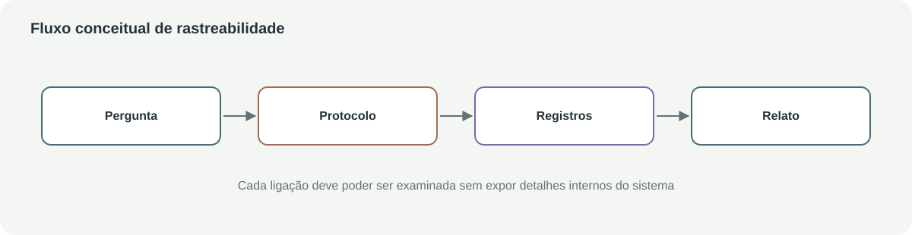
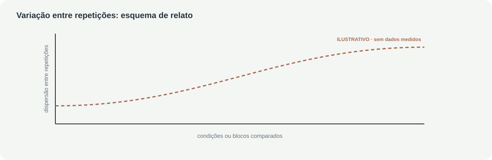

# Reprodutibilidade em avaliações de um sistema de desenho assistido por câmera

## Resumo

Avaliações de sistemas computacionais combinam dados, software, modelos, configurações, infraestrutura e decisões analíticas. Quando esses elementos não são descritos de modo suficiente, leitores têm dificuldade para distinguir variação legítima de mudança não documentada e para interpretar os limites de um resultado. Este artigo propõe um protocolo conceitual de rastreabilidade para avaliar a reprodutibilidade de estudos sobre um sistema de desenho assistido por câmera. A proposta organiza registros em seis grupos: dados, modelos e materiais externos, configuração, ambiente, execução e relato. Uma lista de verificação associa cada registro à finalidade científica que atende, sem prescrever detalhes internos do sistema. O protocolo descreve uma comparação entre a repetição de um experimento em máquinas e datas diferentes, com critérios definidos antes da coleta para classificar concordância, divergência e evidência insuficiente. Também distingue repetição, replicação e reprodução, reconhecendo que as comunidades usam esses termos de maneiras diferentes. O artigo entrega uma estrutura de avaliação, métricas descritivas e ameaças à validade para orientar estudos futuros. Como não há medições apresentadas, nenhum grau de reprodutibilidade é atribuído ao sistema; a aplicação empírica e a escolha de margens aceitáveis permanecem pendentes.

**Palavras-chave:** reprodutibilidade; rastreabilidade; integridade experimental; pesquisa computacional; avaliação de software

## 1. Introdução

Resultados computacionais dependem de uma cadeia de decisões que começa antes da análise e continua durante a execução e a comunicação. A pergunta de pesquisa determina quais observações interessam. A seleção dos dados, os critérios de inclusão, as versões dos artefatos, as condições de execução e as escolhas analíticas delimitam o que os resultados podem sustentar. Se esses elementos ficam dispersos ou implícitos, uma equipe externa pode encontrar uma conclusão sem conseguir avaliar como ela foi produzida. Essa distância reduz a capacidade de detectar erros, comparar estudos e decidir se uma divergência reflete o fenômeno ou uma mudança no procedimento.

A literatura descreve problemas de reprodutibilidade em diferentes áreas, embora os diagnósticos não sejam intercambiáveis. Levantamentos de pesquisadores documentaram preocupação ampla com a dificuldade de reproduzir achados, enquanto análises metodológicas discutiram como práticas de seleção e relato podem enfraquecer a confiança cumulativa [6, 7, 15, 16]. Na pesquisa computacional, a execução de código pode tornar cálculos mais transparentes, mas também acrescenta dependências, ambientes e decisões de software que precisam ser identificados [8–11]. A mera disponibilidade de arquivos, portanto, não demonstra que uma avaliação possa ser interpretada ou repetida. É necessário conectar artefatos a perguntas, condições e afirmações específicas.

Esse problema é particularmente relevante para estudos de interação visual. Uma avaliação de um sistema de desenho assistido por câmera depende de cenas, materiais, participantes quando houver, dispositivos, instruções e critérios de anotação. Pequenas mudanças nesses elementos podem alterar a observação ou sua interpretação. Ao mesmo tempo, divulgar informações suficientes para auditar um estudo não requer expor detalhes internos do sistema. A descrição pode se concentrar na fronteira observável entre condições de entrada, respostas registradas e análise, preservando a distinção entre documentação científica e documentação de implementação.

A pergunta deste artigo é: **quais registros e comparações permitem avaliar, de forma auditável, a reprodutibilidade de estudos sobre um sistema de desenho assistido por câmera?** O objetivo não é afirmar que qualquer lista garante resultados idênticos. A proposta procura explicitar o que deve ser documentado, como estruturar uma tentativa de repetição e como relatar tanto concordância quanto divergência sem ocultar incerteza. A discussão considera que reprodução exata pode ser impraticável quando equipamentos, versões, contextos ou dados não podem ser mantidos constantes.

O artigo oferece três contribuições. Primeiro, organiza uma lista de verificação em seis grupos de registros e relaciona cada item à sua utilidade para interpretar ou auditar uma avaliação. Segundo, define um protocolo conceitual para repetir um experimento em máquinas e datas diferentes, com análise de variação e critérios de decisão previamente documentados. Terceiro, apresenta uma estrutura de relato que separa evidência disponível, inferência e informação ainda ausente. Essas contribuições são propostas metodológicas, não resultados de uma aplicação já realizada.

A seção 2 situa a proposta em pesquisas sobre abertura, documentação de dados e modelos, computação científica e avaliação de sistemas de aprendizado de máquina. A seção 3 define rastreabilidade e apresenta a lista de verificação. A seção 4 especifica as condições, os registros, as medidas e a análise proposta. A seção 5 descreve a forma dos resultados que uma aplicação futura deverá preencher. A seção 6 discute interpretações possíveis; a seção 7 delimita ameaças à validade; e a seção 8 resume o que precisa ser feito antes de qualquer conclusão empírica.

A proposta também diferencia três produtos que às vezes são confundidos: documentação, repetição operacional e confirmação substantiva. Documentação registra como o estudo foi concebido e executado. Repetição operacional examina se outra equipe consegue seguir o procedimento declarado. Confirmação substantiva avalia se as evidências sustentam novamente a interpretação central. Esses produtos se relacionam, mas um não implica automaticamente o outro. Um protocolo pode estar bem documentado e ainda não ser executável em determinado contexto. Uma repetição pode ser executável e produzir divergência informativa. Essa distinção orienta tanto as métricas quanto a linguagem dos resultados, impedindo que a presença de materiais compartilhados seja apresentada como prova de estabilidade empírica.

## 2. Trabalhos relacionados

### 2.1 Reprodutibilidade e transparência na pesquisa empírica

A reprodutibilidade não é uma propriedade simples que possa ser inferida de um único arquivo ou de uma declaração de abertura. Estudos de opinião e debates metodológicos tornaram visível a preocupação com resultados difíceis de reproduzir, mas também alertaram que perguntas, definições e disciplinas variam [6, 7]. A estimativa conduzida pela Open Science Collaboration examinou tentativas de repetição em psicologia e mostrou a importância de explicitar o desenho e os critérios usados para comparar resultados [7]. Esse trabalho não fornece uma taxa transferível a avaliações de sistemas visuais; seu valor aqui é metodológico: sucesso precisa ser definido em relação à pergunta e às evidências disponíveis.

Ioannidis discutiu como vieses, flexibilidade analítica e baixo poder podem reduzir a confiabilidade de achados publicados [15]. Em trabalho posterior, argumentou que incentivos e práticas institucionais também afetam a qualidade cumulativa da evidência [16]. Esses textos sustentam a necessidade de distinguir transparência do procedimento de confirmação do resultado. Um relato completo ajuda terceiros a examinar decisões, mas não elimina viés, erro de medição ou explicações alternativas. A proposta deste artigo adota essa distinção e trata documentação como condição de auditoria, não como garantia de validade.

Princípios de ciência aberta recomendam que métodos, materiais e decisões sejam comunicados de modo compatível com a verificação pública [13, 14]. O valor prático desse compromisso depende de contexto: dados podem conter informação sensível; materiais podem ter restrições de licença; e determinados artefatos podem deixar de funcionar com o tempo. Uma declaração transparente deve informar o que está disponível, o que está restrito e por qual razão, sem tratar indisponibilidade como evidência de má conduta. Para estudos com pessoas, a proteção de participantes limita formas de compartilhamento e exige alternativas, como metadados, descrições e procedimentos de acesso controlado.

A pesquisa computacional acrescenta uma questão: resultados derivados de código são argumentos cuja cadeia de transformação precisa ser examinável. Peng propõe associar artigos computacionais a compêndios que permitam inspecionar dados, código e resultados [8]. Sandve e colegas apresentam recomendações práticas para tornar análises computacionais mais reproduzíveis [9]. McNutt enfatiza a responsabilidade editorial e institucional de elevar a transparência do relato [14]. Em conjunto, esses trabalhos apoiam uma visão de reprodutibilidade como propriedade do processo de pesquisa e de sua documentação, e não como sinônimo de publicar um repositório.

### 2.2 Pesquisa computacional e artefatos de software

Boas práticas de computação científica tratam organização, testes, controle de versões, revisão e documentação como componentes do trabalho empírico [10, 11]. Tais práticas tornam mais provável que decisões sejam explícitas e que erros sejam identificáveis. Elas não substituem a descrição do desenho experimental: um programa bem organizado pode executar uma análise inadequada, e um resultado computável pode depender de dados ou premissas mal documentados. Por isso, a lista proposta neste artigo inclui tanto propriedades dos artefatos quanto relações entre pergunta, protocolo e afirmação.

A citação de software é outro componente necessário. Smith, Katz e Niemeyer defendem que software usado em pesquisa deve receber crédito e identificação apropriados [12]. Uma referência a um projeto sem versão ou identificador persistente pode ser insuficiente para saber qual artefato foi usado. Estudos de pesquisa em software também investigam a possibilidade de reconstruir análises publicadas a partir de materiais disponibilizados [23]. Mapeamentos de replicações e estudos de acompanhamento indicam que disponibilidade, executabilidade e correspondência entre materiais e relato são problemas distintos [24, 25]. Essa literatura ajuda a evitar uma definição estreita segundo a qual basta fornecer código para afirmar que um estudo é reproduzível.

Stodden e Miguez destacam que infraestrutura e ambientes de software influenciam a extensão e a confiabilidade da pesquisa computacional [26]. Baiocchi discute diretrizes para pesquisas computacionais em economia, enfatizando integração entre texto, código, dados e software aberto quando possível [27]. Ferramentas de empacotamento podem apoiar a descrição de ambientes, como ilustra a introdução de Boettiger ao uso de contêineres [20]. A ferramenta específica, porém, não resolve por si só a gestão de dados, as limitações de hardware, a disponibilidade futura de serviços ou a documentação das decisões analíticas. Um ambiente isolado pode reduzir diferenças de instalação sem tornar uma medição externa equivalente em outro equipamento.

Práticas de notebooks computacionais também foram sistematizadas em regras para escrever e compartilhar análises [21]. Fomel e Claerbout situam documentos eletrônicos e computações reproduzíveis como uma mudança na forma de comunicar evidência científica [22]. Trabalhos sobre artefatos em engenharia de software complementam essas recomendações com o problema de reexecutar e interpretar materiais publicados [23–25]. A lacuna relevante é a falta de um protocolo conciso que una esses princípios a uma avaliação experimental de interação visual, sem transformar o artigo em manual de instalação ou em descrição interna do produto.

### 2.3 Avaliação de sistemas de aprendizado de máquina e visão computacional

Princípios FAIR propõem que dados sejam localizáveis, acessíveis, interoperáveis e reutilizáveis, com atenção às condições que tornam cada objetivo viável [1]. Discussões posteriores questionam como operacionalizar esses princípios e o que pode ser considerado suficiente em diferentes contextos [2, 3]. Para este artigo, FAIR oferece uma orientação para dados e metadados, mas não cobre sozinho a execução experimental, a validade dos instrumentos ou a interpretação das métricas. A lista de verificação incorpora rastreabilidade e acesso, sem presumir que todo material possa ou deva ser aberto irrestritamente.

Datasheets para conjuntos de dados organizam informações sobre motivação, composição, coleta, processamento, usos e limitações [4]. Model cards propõem documentar finalidades, condições de avaliação, desempenho e limitações de modelos [5]. Ambos ajudam a tornar pressupostos e contextos visíveis. A aplicação a um estudo de sistema exige cautela: um estudo pode usar dados e modelos externos, mas sua unidade de avaliação inclui também o protocolo, o ambiente e os critérios de análise. Os documentos de dados ou modelos não substituem o relato completo da experiência, nem afirmam que o recurso avaliado funciona para usos que não foram testados.

Na inteligência artificial, Gundersen e Kjensmo mapearam problemas de reprodutibilidade e propuseram maior atenção à descrição de experimentos [19]. Heil e colegas apresentam recomendações de reprodutibilidade para aprendizado de máquina em ciências da vida [17]. Haibe-Kains e colegas discutem transparência e reprodutibilidade em inteligência artificial, observando que a confiança científica requer acesso e relato suficientes para examinar análises [18]. Beam, Manrai e Ghassemi descrevem desafios de reprodução em modelos de aprendizado de máquina aplicados à saúde, onde dados, configurações e populações podem limitar a comparação [29]. Embora o domínio clínico seja diferente, a advertência se aplica de forma geral: mudanças no conjunto de dados ou na população de avaliação podem alterar a interpretação de uma comparação.

Pineau e colegas relatam a iniciativa de reprodutibilidade da NeurIPS e a adoção de uma lista de verificação para artigos de aprendizado de máquina [28]. Desai e colegas discutem o significado de reprodutibilidade em pesquisas de inteligência artificial e aprendizado de máquina [30]. Esses trabalhos mostram que checklists são úteis quando se conectam a decisões concretas de publicação e avaliação. Ainda assim, perguntas binárias podem ocultar diferenças entre informação ausente, informação não aplicável e restrição legítima. A lista deste artigo permite indicar essas situações e requer justificativa quando um item não pode ser fornecido.

Assim, a lacuna não é a inexistência de princípios, listas ou estudos sobre reprodutibilidade. É a necessidade de uma estrutura aplicada a avaliações de um sistema de desenho assistido por câmera que una registro de materiais, comparação entre execuções e interpretação de resultados. A proposta traduz orientações gerais em itens auditáveis, estabelece categorias para relatar variação entre condições e deixa explícito que nenhuma lista substitui dados, instrumentos adequados ou julgamento científico.

## 3. Enquadramento do problema

Neste artigo, reprodutibilidade significa a possibilidade de uma equipe avaliar se um resultado pode ser obtido novamente sob condições descritas e se eventuais diferenças podem ser interpretadas. A definição inclui mais que repetição numérica. Um resultado pode variar entre execuções e ainda ser informativo, desde que a variação seja medida, justificada e relacionada à pergunta. Também pode haver concordância aparente sem reprodutibilidade substantiva, por exemplo quando duas equipes calculam a mesma métrica sobre dados diferentes sem reconhecer a mudança. A unidade de análise, portanto, é a relação entre uma afirmação, as evidências que a sustentam, as condições registradas e a análise aplicada.

Rastreabilidade é a capacidade de seguir essa relação ao longo do estudo. Cada conclusão deve apontar para uma análise; cada análise, para observações e definições; e cada observação, para condições e materiais identificáveis. O encadeamento pode ser resumido em quatro elementos: pergunta, protocolo, registros e relato. A Figura 1 apresenta essa ligação como uma estrutura conceitual. Ela não representa etapas internas de um sistema. Seu propósito é mostrar que documentação dispersa impede a interpretação de como uma afirmação se conecta ao procedimento que a produziu.

**Figura 1.** Fluxo conceitual de rastreabilidade entre pergunta, protocolo, registros e relato. As caixas representam evidências examináveis por terceiros, sem descrever componentes internos do sistema avaliado. Elaboração própria.

Uma lista de verificação é útil quando serve a uma decisão observável, em vez de funcionar como inventário burocrático. Cada item deve responder a duas perguntas: o que precisa ser registrado para interpretar a avaliação e por que esse registro é necessário? A Tabela 1 agrupa itens em seis áreas. O conjunto não presume que todos os itens se apliquem a todo estudo. O relato deve marcar itens como aplicáveis, não aplicáveis ou restritos, explicando a justificativa. Uma informação não disponível não deve ser silenciosamente convertida em “não aplicável”.

**Tabela 1.** Lista de verificação organizada por dados, modelos, configuração, ambiente, execução e relato; cada item explicita o que registrar e por que a informação sustenta auditoria, repetição ou interpretação dos resultados.

| Grupo | O que registrar | Por quê |
|---|---|---|
| Dados | Origem e responsável pela coleta | Permite avaliar proveniência e contexto de obtenção. |
| Dados | Critérios de inclusão e exclusão | Delimita a população de observações analisada. |
| Dados | Esquema de anotação e instruções | Torna interpretável a produção dos rótulos. |
| Dados | Identificador ou descrição da versão | Distingue revisões e subconjuntos usados. |
| Dados | Restrições de acesso, licença e privacidade | Explica o que pode ser compartilhado e em quais condições. |
| Modelos e materiais externos | Identificação do recurso e sua origem | Permite localizar dependências externas relevantes. |
| Modelos e materiais externos | Versão, data ou identificador persistente | Reduz ambiguidade sobre o material efetivamente empregado. |
| Modelos e materiais externos | Finalidade e limites conhecidos | Evita extrapolar alegações para usos não avaliados. |
| Configuração | Opções definidas para a avaliação | Ajuda a distinguir variação planejada de alteração acidental. |
| Configuração | Justificativa das escolhas | Conecta decisões operacionais à pergunta de pesquisa. |
| Ambiente | Classe geral do equipamento e sistema operacional | Ajuda a contextualizar diferenças entre execuções. |
| Ambiente | Condições físicas e de captura relevantes | Identifica fatores externos que podem alterar observações. |
| Ambiente | Dependências e serviços externos relevantes | Permite reconhecer requisitos de execução e disponibilidade. |
| Execução | Data, responsável e identificador da sessão | Ordena ocorrências e ajuda a investigar divergências. |
| Execução | Desvios, interrupções e falhas | Evita que execuções incompletas sejam tratadas como equivalentes. |
| Execução | Critério de encerramento e repetição | Define como resultados ausentes ou incompletos serão tratados. |
| Relato | Definições das métricas e unidades | Torna comparáveis valores e interpretações. |
| Relato | Plano analítico e alterações posteriores | Distingue escolhas prévias de decisões motivadas pelos dados. |
| Relato | Dados, código e materiais disponíveis ou restritos | Permite verificar o alcance real da auditoria independente. |
| Relato | Incerteza, limitações e resultados não conclusivos | Evita apresentar uma concordância parcial como confirmação plena. |

Os seis grupos cobrem elementos relacionados, mas não idênticos. Dados referem-se às observações analisadas e aos processos usados para produzi-las. Modelos e materiais externos incluem recursos que podem ser obtidos de outras equipes ou distribuidores. Configuração descreve escolhas controláveis para a avaliação, sem enumerar detalhes internos do sistema. Ambiente registra características do contexto computacional e físico. Execução documenta o que ocorreu em cada sessão. Relato reúne as definições, análises e limitações que permitem interpretar a evidência. Essa separação ajuda a localizar lacunas sem sugerir que uma categoria isolada explique toda divergência.

Uma diferença conceitual adicional envolve os termos repetição, replicação e reprodução. Algumas comunidades reservam “repetir” para a mesma equipe e os mesmos materiais, “replicar” para outra equipe com o mesmo protocolo e “reproduzir” para uma implementação independente. Outras usam os termos de modo distinto ou trocam suas definições. O artigo não impõe uma taxonomia universal. Propõe que os autores definam os termos antes de apresentar uma comparação. A Figura 2 ilustra uma convenção possível e deixa visível que as categorias variam em equipe, materiais e implementação.

**Figura 2.** Níveis conceituais de repetir, replicar e reproduzir distinguem alterações de equipe, materiais e implementação. A nomenclatura depende da convenção declarada pelos autores e não estabelece uma hierarquia universal. Elaboração própria.

A variação aceitável não pode ser escolhida depois de observar os resultados sem justificativa. Ela depende da finalidade da métrica, da precisão do instrumento, da variabilidade esperada e do custo de uma decisão incorreta. Para métricas contínuas, uma margem de equivalência precisa de interpretação substantiva e justificativa anterior à comparação. Para métricas categóricas, o protocolo deve declarar como tratar discordâncias e dados ausentes. Se não houver base para fixar uma margem, o estudo deve apresentar a distribuição observada e classificá-la como descritiva, sem afirmar equivalência.

Rastreabilidade também não significa guardar indiscriminadamente todos os dados. Dados de participantes, imagens incidentais e informações que possam revelar identidade devem ser tratados conforme consentimento, aprovação ética e restrições aplicáveis. Metadados, estatísticas agregadas e descrições de procedimento podem apoiar auditoria sem expor material sensível. A decisão de restringir acesso precisa ser registrada com sua justificativa e, quando possível, acompanhada por uma via controlada de consulta. Assim, transparência e proteção não são metas automaticamente incompatíveis, mas exigem decisões explícitas.

## 4. Protocolo de avaliação proposto

O protocolo propõe um estudo de caso conceitual: uma equipe repete a avaliação de um sistema de desenho assistido por câmera em máquinas e datas diferentes. A comparação procura saber se o procedimento pode ser seguido, se as observações são interpretáveis e como as medidas variam. Não se pressupõe que duas execuções produzam valores idênticos. A equipe define previamente o que considera repetição, quais evidências serão registradas, quais métricas respondem à pergunta e quais resultados podem ser classificados como inconclusivos.

**Condições e desenho.** A avaliação descreve uma tarefa visual delimitada, os materiais apresentados, as instruções e o estado inicial observável. A amostra de cenas deve refletir a pergunta e não apenas casos convenientes. Quando houver participantes, o protocolo informa recrutamento, consentimento, critérios de inclusão e características relevantes de forma compatível com a proteção de identidade. Quando as observações forem cenas preparadas sem participantes, a equipe explica como foram construídas e quais variações pretendem representar. O artigo não antecipa resultados nem fixa níveis de desempenho.

A primeira execução estabelece o procedimento de referência. Uma equipe registra o protocolo, os materiais e as decisões de análise antes de iniciar a repetição. Outra execução ocorre em data distinta e em equipamento de classe diferente, mantendo as condições que o estudo definiu como necessárias para comparação. A classe do equipamento, o contexto físico, a versão identificável dos materiais e qualquer desvio devem ser registrados. Uma mudança inevitável não invalida automaticamente a comparação; ela limita a interpretação e precisa ser tratada como fator potencial de variação.

**Dados e integridade dos registros.** Cada conjunto de observações recebe um identificador persistente no âmbito do estudo. O caderno de dados descreve origem, coleta, anotação, exclusões e restrições. As anotações são acompanhadas por definições operacionais e por procedimento de resolução de discordâncias. Se dados não puderem ser compartilhados, o relato explica a restrição e indica quais sumários, metadados ou revisões controladas podem ser disponibilizados. Modelos e materiais externos são identificados por origem, versão ou data, e finalidade. Nenhuma dessas informações deve expor mecanismos internos do sistema avaliado.

**Execução e condições.** Para cada sessão, registra-se data, equipe responsável, classe do equipamento, configuração da avaliação, duração observável, interrupções e desvios. A ordem das condições é definida antes da coleta ou randomizada quando isso for compatível com o desenho. Se houver risco de aprendizagem, fadiga ou mudança de cena, o protocolo explica como esses efeitos serão tratados. Uma sessão interrompida não é descartada sem motivo registrado. A equipe distingue falha operacional, ausência de observação e resultado negativo, pois esses eventos têm significados diferentes.

**Métricas.** O protocolo separa medidas de completude documental, concordância entre repetições e possibilidade de auditoria. A completude é descrita por item aplicável, preenchido, ausente ou restrito, sempre com justificativa. A concordância é resumida por diferenças pareadas entre execuções para medidas contínuas e por tabelas de concordância para categorias. Quando adequado ao desenho, intervalos de incerteza são estimados por procedimento declarado. Não se usa uma única pontuação composta para substituir a interpretação dos itens: duas execuções podem concordar em uma métrica e divergir em outra. A Tabela 2 relaciona práticas existentes às evidências examináveis, a indicadores descritivos compatíveis com o protocolo e aos limites de interpretação de cada medida.

**Tabela 2.** Comparação entre práticas de transparência, documentação de dados e modelos, revisão de artefatos e registro de execução, relacionando finalidade, evidência verificável e limite de cada prática.

| Prática | Finalidade | Indicador descritivo | Evidência examinável | Limite interpretativo |
|---|---|---|---|---|
| Princípios FAIR | Apoiar localização, acesso, interoperabilidade e reutilização de dados | Campos de metadados aplicáveis documentados | Metadados disponíveis e condições de acesso descritas | Não determina validade experimental nem exige acesso irrestrito. |
| Datasheet de dados | Documentar origem, composição, coleta e usos | Itens aplicáveis preenchidos ou justificados | Descrição de origem, coleta e limitações | Não descreve sozinho a execução completa do estudo. |
| Model card | Contextualizar finalidade, avaliação e limites de um modelo | Condições de avaliação descritas para o recurso | Finalidade, contexto e limites declarados | Não substitui avaliação independente do sistema em contexto. |
| Lista de reprodutibilidade | Promover relato sistemático de métodos e materiais | Itens aplicáveis com evidência, ausência ou justificativa | Registro por item e motivo de não atendimento | Uma resposta afirmativa não comprova correção ou equivalência. |
| Revisão de artefatos | Examinar disponibilidade e possibilidade de uso dos materiais | Materiais localizáveis e possibilidade de inspeção | Acesso, documentação e execução conforme escopo definido | A execução bem-sucedida não confirma todas as conclusões. |
| Registro por sessão | Preservar contexto e desvios de cada execução | Campos completos, ausentes ou restritos por sessão | Registros associados a cada sessão | Mais registro não elimina erro de medição nem viés. |

**Análise.** A análise começa por verificar se as execuções correspondem ao protocolo declarado. A equipe documenta itens divergentes e decide se cada diferença é compatível com a comparação planejada. Em seguida, apresenta estatísticas descritivas por condição, diferenças entre execuções e incerteza, sem reduzir os resultados a uma afirmação binária de “reproduziu” ou “não reproduziu”. Se houver uma margem de equivalência justificada, a comparação pode avaliar se as diferenças se mantêm dentro dela. Caso contrário, reporta-se a dispersão observada e evita-se declarar equivalência. Divergências são investigadas com base nos registros disponíveis, mas a associação entre uma mudança e uma diferença não estabelece causalidade.

A Figura 3 mostra somente uma forma possível de exibir a variação entre repetições. Como não há observações neste artigo, a curva não codifica estimativas, valores numéricos ou tendência empírica. Em uma aplicação, a figura seria substituída por uma visualização construída a partir dos dados, com descrição da unidade, do procedimento de sumarização e da incerteza. A legenda deve declarar claramente que a forma esperada, não é resultado quando o desenho for mantido como esquema sem dados.

**Figura 3.** Curva ilustrativa da variação entre repetições, com eixos sem valores porque não há medições disponíveis. A forma esperada, não é resultado; o esquema apenas orienta uma apresentação futura da dispersão observada. Elaboração própria.

**Ameaças e salvaguardas analíticas.** A variação entre máquinas pode refletir diferenças de equipamento, condições ambientais ou procedimentos de coleta, e não uma única causa. Mudanças entre datas podem coincidir com alterações nos materiais ou nas pessoas envolvidas. O protocolo registra esses fatores e evita atribuir uma diferença a um deles sem comparação adequada. A equipe ainda pré-especifica critérios de exclusão, tratamento de ausências, desfechos principais e análise. Alterações necessárias ficam registradas com data e justificativa. Essa disciplina não impede decisões adaptativas, mas permite que leitores distingam o plano inicial das escolhas posteriores.

Por fim, uma revisão independente verifica se os materiais descritos correspondem ao relato e se uma pessoa externa consegue localizar as evidências associadas a cada afirmação. Essa revisão não precisa reconstruir o sistema. Seu objeto é o estudo: clareza da pergunta, acesso ou restrição dos materiais, coerência entre protocolo e análise, e apresentação de incertezas. A proposta deve ser registrada antes da coleta, incluindo responsáveis, consentimentos e condições de acesso. A aplicação empírica permanece necessária para avaliar se esses itens são praticáveis e suficientes em estudos reais.

## 5. Estrutura dos resultados

Uma aplicação do protocolo deverá começar informando quais itens da lista de verificação foram aplicáveis, preenchidos, ausentes ou restritos, e quais justificativas foram fornecidas. Essa síntese não será um placar de qualidade. Sua função é mostrar que evidências estão disponíveis para interpretar a comparação. O relato deverá descrever as execuções realizadas, as condições que permaneceram constantes, as mudanças entre sessões e os desvios do protocolo. Toda diferença relevante deve ser apresentada junto com o registro que permite examiná-la.

As medidas de resultado incluirão diferenças entre execuções para cada desfecho previamente selecionado, sumários de dispersão e intervalos de incerteza quando forem compatíveis com o desenho. Para dados categóricos, serão informadas as categorias comparadas e as discordâncias observadas. Para dados ausentes, o relatório indicará sua origem conhecida ou declarará que a causa não pôde ser determinada. Não se inferirá equivalência apenas pela ausência de diferença estatisticamente detectável. Se não houver uma margem de equivalência justificável, os resultados serão tratados como descritivos.

A Figura 3 oferece apenas uma orientação visual. A forma esperada, não é resultado e não deverá ser interpretada como tendência observada. Uma versão empírica futura deverá apresentar somente observações efetivamente coletadas, com legenda que identifique condições, medida, incerteza e exclusões. A Tabela 3 registra os campos que deverão ser preenchidos quando houver dados. Neste manuscrito, todos permanecem [PENDENTE-DADOS].

**Tabela 3.** Estrutura de resultados a preencher após a coleta: cada linha associa uma pergunta de comparação à evidência e à análise prevista, mantendo explícita a ausência atual de medições.

| Campo de resultado | Conteúdo a relatar |
|---|---|
| Completude dos registros | [PENDENTE-DADOS] |
| Concordância por desfecho | [PENDENTE-DADOS] |
| Diferenças entre condições | [PENDENTE-DADOS] |
| Dados ausentes e desvios | [PENDENTE-DADOS] |
| Interpretação e incerteza | [PENDENTE-DADOS] |

## 6. Discussão

A estrutura proposta trata reprodutibilidade como uma pergunta empírica e não como atributo conferido pela intenção dos autores. Um primeiro desfecho possível seria a concordância entre execuções sob as condições planejadas. Esse resultado sugeriria que, para aquele protocolo e contexto, a variação observada é compatível com a margem previamente justificada. Não demonstraria que o sistema funciona em todo equipamento, tarefa ou população. A inferência dependeria da cobertura de condições, da precisão das medidas e da qualidade dos registros. Uma concordância restrita deve ser relatada como tal.

Um segundo desfecho possível seria a concordância em algumas medidas e divergência em outras. Isso indicaria que a avaliação é sensível a certos desfechos ou condições, enquanto outros permanecem estáveis no escopo observado. Uma interpretação útil examinaria se as medidas diferem em escala, sensibilidade ou dependência contextual. A conclusão não deve comprimir padrões mistos em um rótulo global de sucesso ou falha. Essa recomendação está alinhada à literatura que separa disponibilidade de artefatos, transparência das decisões e validade de uma conclusão [17–19, 28].

Um terceiro desfecho seria uma divergência ampla entre execuções. Ela pode revelar insuficiência de documentação, mudanças de contexto, variação legítima ou falhas de medição. O protocolo permite distinguir essas possibilidades apenas quando os registros sustentam a investigação. Caso faltem dados sobre uma alteração, atribuir a divergência a uma causa específica excederia a evidência. Uma divergência replicada em condições documentadas pode, por outro lado, mostrar que o comportamento varia e que a média isolada não descreve adequadamente o sistema. A literatura de software empírico reforça a importância de disponibilizar pacotes interpretáveis e de examinar o que é efetivamente reconstruível [23–26].

Um quarto desfecho seria evidência insuficiente. Isso pode ocorrer se materiais não estiverem acessíveis, se definições de métricas forem ambíguas, se mudanças entre sessões não forem registradas ou se o número e a cobertura das observações não responderem à pergunta. “Insuficiente” não equivale a “não reproduzido”. A distinção impede que lacunas documentais sejam convertidas em afirmação sobre o comportamento do sistema. Também orienta a próxima etapa de pesquisa: revisar o protocolo, completar os registros ou ampliar a coleta, conforme a fonte da insuficiência.

A proposta dialoga com FAIR, datasheets e model cards ao transformar princípios de documentação em perguntas sobre procedência, contexto e limites [1–5]. Esses instrumentos são complementares. Um datasheet descreve um conjunto de dados; um model card contextualiza um modelo; FAIR organiza objetivos para gestão e reutilização. Nenhum deles, isoladamente, acompanha todas as decisões de uma avaliação de interação. A lista de verificação incorpora essas práticas sem tratá-las como certificação de qualidade. A comparação com checklists de aprendizado de máquina também mostra que uma lista tem maior valor quando cada item pede uma evidência ou justificativa, em vez de uma confirmação abstrata [17, 19, 28, 30].

A aplicação em um sistema de desenho assistido por câmera oferece um caso delimitado para testar essa estrutura. Seu valor científico dependerá de avaliar se os itens são compreensíveis, se equipes externas conseguem preenchê-los e se as medidas distinguem mudanças documentais de variação nos resultados. Isso exige um estudo real, revisão por pessoas que não elaboraram o protocolo e ajustes antes de propor generalizações. O artigo não antecipa esse resultado. Seu argumento é que a rastreabilidade pode tornar as condições de interpretação mais explícitas e que essa alegação deve ser avaliada, não presumida.
 Uma leitura cuidadosa deve ainda distinguir uma divergência que altera a decisão prática de outra que muda apenas a apresentação de um sumário. Essa distinção dependerá do uso pretendido e deve ser justificada antes da análise. Ao publicar tanto padrões compatíveis quanto divergentes, o estudo poderá contribuir para refinar protocolos futuros sem converter um único caso em recomendação universal.

## 7. Limitações e ameaças à validade

A validade interna pode ser ameaçada por mudanças simultâneas em equipamento, ambiente, materiais e equipe. Se as execuções diferirem em vários aspectos, a comparação não identifica qual diferença explica a variação. Uma lista de registro ajuda a observar mudanças, mas não as controla. O protocolo pode reduzir essa ambiguidade por planejamento e documentação, porém a decisão de manter ou variar cada condição depende da pergunta. A ordem das tarefas, aprendizagem, fadiga e interrupções também podem influenciar observações quando pessoas participam. A aplicação deverá explicitar essas possibilidades e não atribuir efeito causal sem desenho adequado.

A validade de construção depende da adequação das medidas ao conceito de reprodutibilidade. Completude documental mede presença de registros, não sua verdade ou suficiência. Concordância numérica mede semelhança segundo uma métrica, mas pode ocultar diferenças importantes na experiência ou na distribuição de erros. Uma margem de equivalência sem justificativa pode dar aparência de rigor a uma decisão arbitrária. A análise precisa relacionar cada medida à pergunta, reportar unidade e incerteza, e preservar resultados desagregados quando uma síntese puder esconder padrões distintos.

A validade externa é limitada pela escolha das tarefas, condições e equipamentos. Uma repetição em máquinas distintas constitui evidência para aquelas classes e condições, não para todo ambiente de uso. Estudos com amostras de conveniência, cenas preparadas ou poucos contextos podem não representar usos cotidianos. A transferência para outras tarefas, populações ou contextos requer evidência adicional. Os princípios de documentação citados são gerais, mas a utilidade de cada item pode variar por domínio, disponibilidade de dados e restrições institucionais.

A validade dos dados envolve qualidade de anotação, cobertura de condições, perdas, privacidade e mudanças de versão. Anotações podem divergir mesmo com instruções compartilhadas. Dados indisponíveis reduzem a possibilidade de auditoria, mas sua restrição pode ser necessária para proteger participantes ou cumprir licenças. Uma descrição pública dos critérios e das restrições melhora a transparência, embora não permita reproduzir observações inacessíveis. O estudo deve separar o que foi preservado, o que pode ser compartilhado e o que permanece impossível de verificar.

Por fim, a proposta ainda não foi aplicada nem avaliada por equipes independentes. A taxonomia pode omitir itens ou agrupar de modo pouco útil decisões que pesquisadores fariam separadamente. O protocolo pode impor custo de documentação maior que o benefício em estudos exploratórios pequenos. A lista poderá precisar de adaptação após pilotos, desde que alterações sejam justificadas e não apresentadas como requisitos universais. A literatura revisada também não esgota as práticas disponíveis. Essas limitações tornam a proposta uma base para avaliação metodológica, não um padrão validado.
 Um piloto poderá testar a clareza dos itens, a carga de preenchimento e a capacidade de localizar registros, mas esse piloto ainda não demonstrará validade externa. A versão final deverá indicar quais alterações decorreram desse teste e quais perguntas permanecem abertas.

## 8. Conclusão

Este artigo propôs uma estrutura para avaliar a reprodutibilidade de estudos sobre um sistema de desenho assistido por câmera. A estrutura organiza registros de dados, materiais externos, configuração, ambiente, execução e relato; define uma comparação entre execuções em máquinas e datas diferentes; e separa concordância, divergência e evidência insuficiente. Também distingue documentação, repetição operacional e confirmação substantiva, evitando tratar disponibilidade de materiais como garantia de validade.

O protocolo ainda exige aplicação empírica, revisão independente e justificativa contextual para margens de variação. Sem essas etapas e sem dados coletados, não é possível afirmar que a avaliação proposta funciona ou que o sistema seja reprodutível. Uma pesquisa futura deverá preencher os campos pendentes, documentar desvios e restringir conclusões às condições realmente observadas.
 Também deverá escolher uma definição de repetição adequada à comunidade e declarar como a equipe lidará com mudanças de materiais ou restrições de acesso. Se os registros permitirem apenas uma comparação parcial, essa limitação precisa aparecer junto à conclusão. Assim, o protocolo poderá ser avaliado pelo grau em que esclarece decisões e evidencia lacunas, sem prometer identidade entre execuções.

## Declarações

- Uso de IA generativa: texto redigido com apoio de IA generativa, com revisão e responsabilidade dos autores; referências conferidas por DOI.
- Dados: este artigo conceitual não apresenta dados empíricos; dados de estudos futuros serão descritos conforme consentimento, ética e condições de acesso.
- Código: não há código de análise associado a resultados empíricos neste manuscrito.
- Conflito de interesses: os autores deverão declarar conflitos pertinentes antes da submissão.
- Ética: este artigo não relata estudo com participantes; qualquer coleta futura deverá obter aprovação ética e consentimento aplicável.
- Contribuição dos autores: a contribuição individual de cada autor deverá ser descrita na versão submetida.

## Referências

[1] Wilkinson, M. D.; Dumontier, M.; Aalbersberg, I. J. et al. The FAIR Guiding Principles for scientific data management and stewardship. Scientific Data, 2016. https://doi.org/10.1038/sdata.2016.18
[2] Boeckhout, M.; Zielhuis, G. A.; Bredenoord, A. L. The FAIR guiding principles for data stewardship: fair enough? European Journal of Human Genetics, 2018. https://doi.org/10.1038/s41431-018-0160-0
[3] Anjaria, K. A. Computational implementation and formalism of FAIR data stewardship principles. Data Technologies and Applications, 2020. https://doi.org/10.1108/dta-09-2019-0164
[4] Gebru, T.; Morgenstern, J.; Vecchione, B. et al. Datasheets for datasets. Communications of the ACM, 2021. https://doi.org/10.1145/3458723
[5] Mitchell, M.; Wu, S.; Zaldivar, A. et al. Model Cards for Model Reporting. Proceedings of the Conference on Fairness, Accountability, and Transparency, 2019. https://doi.org/10.1145/3287560.3287596
[6] Baker, M. 1,500 scientists lift the lid on reproducibility. Nature, 2016. https://doi.org/10.1038/533452a
[7] Open Science Collaboration. Estimating the reproducibility of psychological science. Science, 2015. https://doi.org/10.1126/science.aac4716
[8] Peng, R. D. Reproducible Research in Computational Science. Science, 2011. https://doi.org/10.1126/science.1213847
[9] Sandve, G. K.; Nekrutenko, A.; Taylor, J.; Hovig, E. Ten Simple Rules for Reproducible Computational Research. PLoS Computational Biology, 2013. https://doi.org/10.1371/journal.pcbi.1003285
[10] Wilson, G.; Aruliah, D. A.; Brown, C. T. et al. Best Practices for Scientific Computing. PLoS Biology, 2014. https://doi.org/10.1371/journal.pbio.1001745
[11] Wilson, G.; Bryan, J.; Cranston, K. et al. Good enough practices in scientific computing. PLOS Computational Biology, 2017. https://doi.org/10.1371/journal.pcbi.1005510
[12] Smith, A. M.; Katz, D. S.; Niemeyer, K. E. Software citation principles. PeerJ Computer Science, 2016. https://doi.org/10.7717/peerj-cs.86
[13] Nosek, B. A.; Alter, G.; Banks, G. C. et al. Promoting an open research culture. Science, 2015. https://doi.org/10.1126/science.aab2374
[14] McNutt, M. Reproducibility. Science, 2014. https://doi.org/10.1126/science.1250475
[15] Ioannidis, J. P. A. Why Most Published Research Findings Are False. PLoS Medicine, 2005. https://doi.org/10.1371/journal.pmed.0020124
[16] Ioannidis, J. P. A. How to Make More Published Research True. PLoS Medicine, 2014. https://doi.org/10.1371/journal.pmed.1001747
[17] Heil, B. J.; Hoffman, M. M.; Markowetz, F. et al. Reproducibility standards for machine learning in the life sciences. Nature Methods, 2021. https://doi.org/10.1038/s41592-021-01256-7
[18] Haibe-Kains, B.; Adam, G. A.; Hosny, A. et al. Transparency and reproducibility in artificial intelligence. Nature, 2020. https://doi.org/10.1038/s41586-020-2766-y
[19] Gundersen, O. E.; Kjensmo, S. State of the Art: Reproducibility in Artificial Intelligence. Proceedings of the AAAI Conference on Artificial Intelligence, 2018. https://doi.org/10.1609/aaai.v32i1.11503
[20] Boettiger, C. An introduction to Docker for reproducible research. ACM SIGOPS Operating Systems Review, 2015. https://doi.org/10.1145/2723872.2723882
[21] Rule, A.; Birmingham, A.; Zuniga, C. et al. Ten simple rules for writing and sharing computational analyses in Jupyter Notebooks. PLOS Computational Biology, 2019. https://doi.org/10.1371/journal.pcbi.1007007
[22] Fomel, S.; Claerbout, J. F. Guest Editors' Introduction: Reproducible Research. Computing in Science & Engineering, 2009. https://doi.org/10.1109/MCSE.2009.14
[23] González-Barahona, J. M.; Robles, G. On the reproducibility of empirical software engineering studies based on data retrieved from development repositories. Empirical Software Engineering, 2012. https://doi.org/10.1007/s10664-011-9181-9
[24] da Silva, F. Q. B.; Suassuna, M.; França, A. C. C. et al. Replication of empirical studies in software engineering research: a systematic mapping study. Empirical Software Engineering, 2012. https://doi.org/10.1007/s10664-012-9227-7
[25] González-Barahona, J. M.; Robles, G. Revisiting the reproducibility of empirical software engineering studies based on data retrieved from development repositories. Information and Software Technology, 2023. https://doi.org/10.1016/j.infsof.2023.107318
[26] Stodden, V.; Miguez, S. Best Practices for Computational Science: Software Infrastructure and Environments for Reproducible and Extensible Research. Journal of Open Research Software, 2014. https://doi.org/10.5334/jors.ay
[27] Baiocchi, G. Reproducible research in computational economics: guidelines, integrated approaches, and open source software. Computational Economics, 2007. https://doi.org/10.1007/s10614-007-9084-4
[28] Pineau, J.; Vincent-Lamarre, P.; Sinha, K. et al. Improving Reproducibility in Machine Learning Research (A Report from the NeurIPS 2019 Reproducibility Program). Journal of Machine Learning Research, 2021. https://www.jmlr.org/papers/v22/20-303.html
[29] Beam, A. L.; Manrai, A. K.; Ghassemi, M. Challenges to the Reproducibility of Machine Learning Models in Health Care. JAMA, 2020. https://doi.org/10.1001/jama.2019.20866
[30] Desai, A.; Abdelhamid, M.; Padalkar, N. R. et al. What is reproducibility in artificial intelligence and machine learning research? AI Magazine, 2025. https://doi.org/10.1002/aaai.70004
